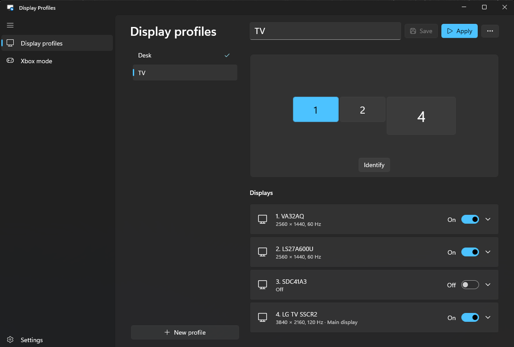
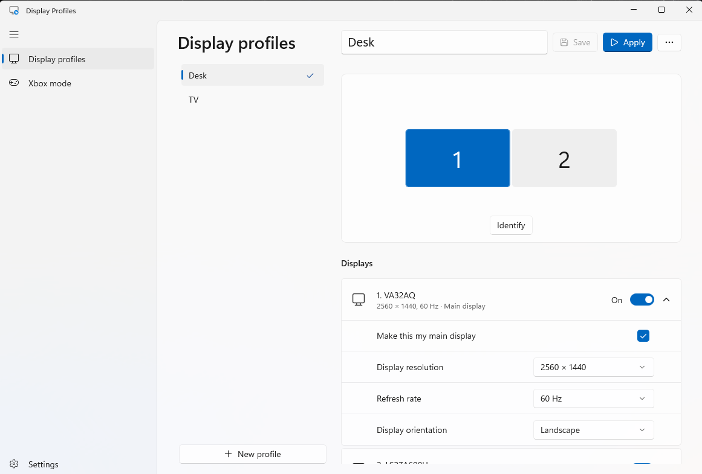
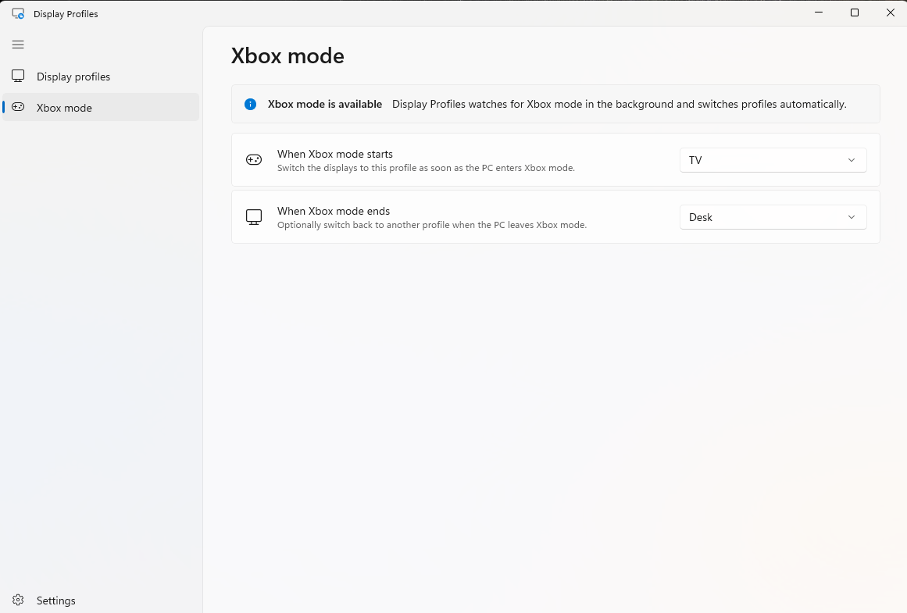
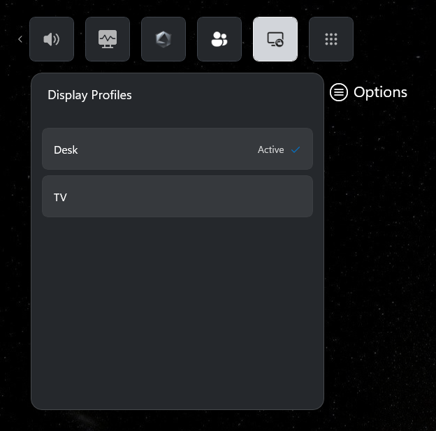
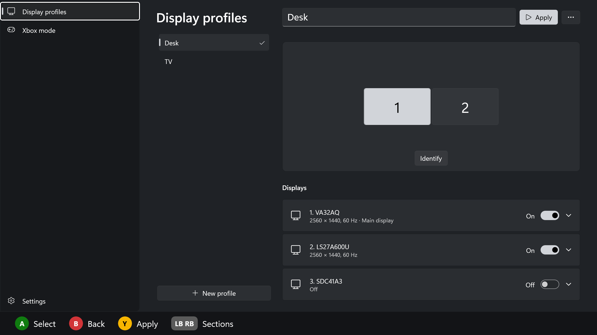
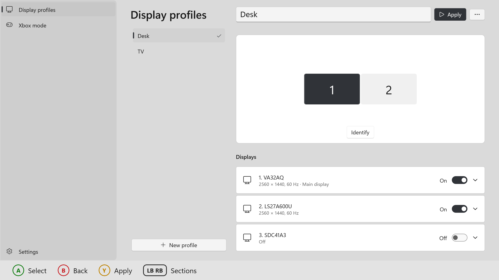
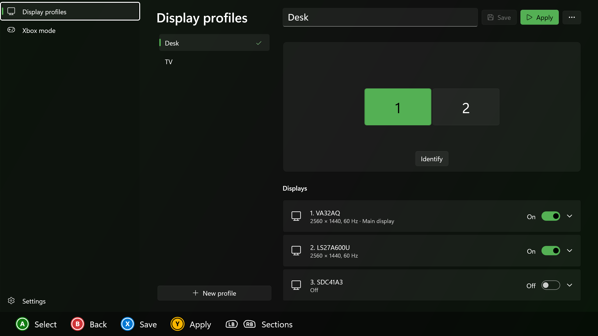
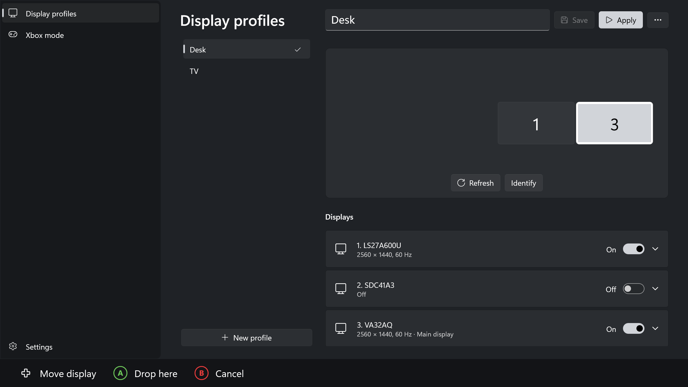
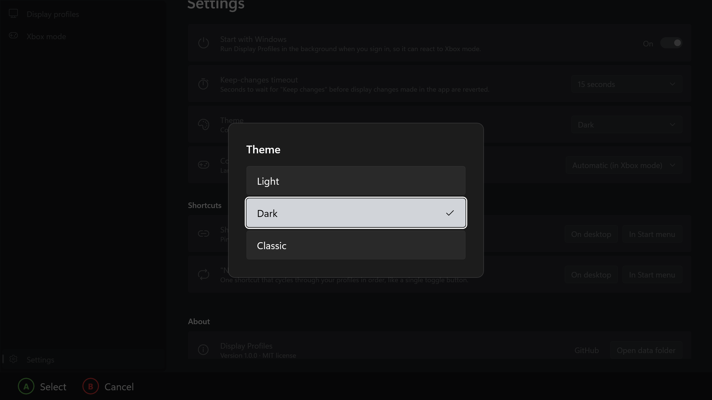
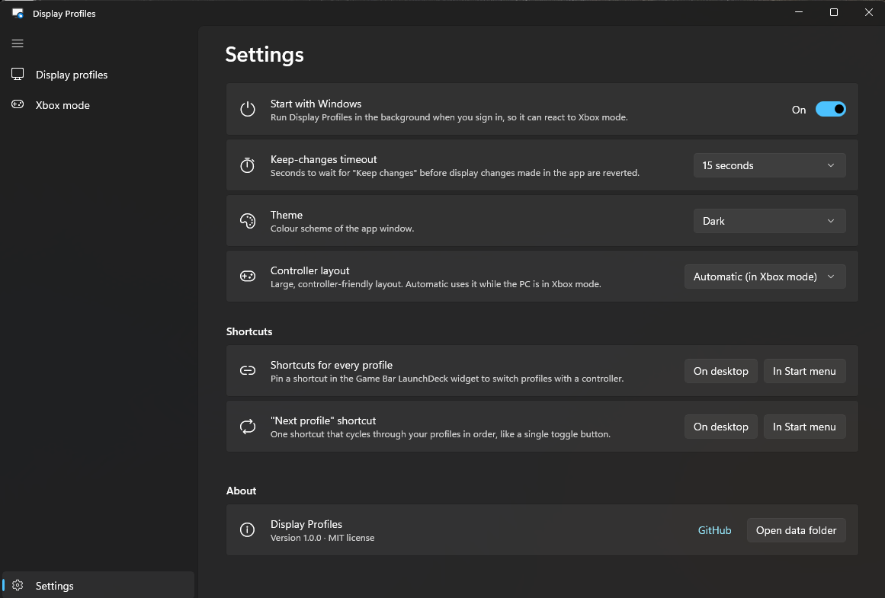

<p align="center">
  
</p>

<h1 align="center">Display Profiles</h1>

<p align="center">
  Save your monitor layouts as profiles and switch between them in one click, one command, or one button press on a controller.
  <br />
  A native-looking Windows 11 app, written in C# on .NET 11 and WinUI 3.
</p>

<p align="center">
  <a href="https://github.com/joshlove007/DisplayProfiles/actions/workflows/ci.yml"></a>
  <a href="https://github.com/joshlove007/DisplayProfiles/releases"></a>
  <a href="LICENSE"></a>
</p>

<p align="center">
  
  
</p>

## Why

Going from "two monitors at my desk" to "the TV from the couch" in Windows means opening Display settings, enabling the TV,
making it the main display, and then doing the whole dance in reverse to come back. Display Profiles turns each of those
setups into a named profile that you apply with a single action. It was built for exactly that: a desk with two monitors,
a TV for gaming, and an Xbox controller.

## Features

- **Profile editor** with a draggable, snapping monitor map like Settings > Display, per-display on/off, main display,
  resolution, refresh rate and orientation, and a choice of extending the desktop or duplicating another display.
  Edits stay in the editor until you press **Save**, so you can try a layout
  with **Apply** before deciding to keep it.
- **Safe applying.** The app checks that every monitor really came up (retrying if a TV is slow to wake), restores your
  previous layout if Windows rejects the change, and shows a "Keep these display settings?" prompt when you apply from the app.
- **Switch from anywhere:** the tray icon, the command line, desktop and Start menu shortcuts, or the Xbox Game Bar widget.
- **Xbox mode.** Choose a profile to apply when the PC enters Xbox mode, and optionally another for when it leaves.
- **Controller mode.** In Xbox mode the app switches to a large, full-screen, controller-friendly layout that you can drive
  entirely with a gamepad, including moving displays around.
- **Looks like Windows.** WinUI 3, Mica, Segoe Fluent icons and your system accent colour, in light or dark.
- **Yours to keep.** Profiles are a plain JSON file in `%APPDATA%\DisplayProfiles`.

<p align="center">
  
  
</p>

## Install

Download the package for your PC from the [Releases](https://github.com/joshlove007/DisplayProfiles/releases) page:

| File | For |
|---|---|
| `DisplayProfiles-<version>-x64.msix` | Intel and AMD PCs |
| `DisplayProfiles-<version>-arm64.msix` | Windows on ARM PCs (Snapdragon and similar) |

Double-click the file and choose **Install**. That's all: the package is signed with a Microsoft-trusted certificate, it
needs no administrator rights and no certificate to import, and it includes the Xbox Game Bar widget, so there is nothing
else to set up. Updates install over the old version the same way, and **Settings > Apps** removes it, widget included.

Requires Windows 11 (or Windows 10 version 2004 or later). The .NET runtime is included. Display Profiles starts with Windows
by default so it can react to Xbox mode; turn that off in Settings or in **Task Manager > Startup apps**.

> [!NOTE]
> The releases are built by [GitHub Actions](.github/workflows/release.yml) from the tagged source, so you can compare them
> with what is in this repository. The ARM64 package is built the same way as the x64 one but hasn't been tried on real
> ARM hardware yet. Please open an issue if something doesn't work.

### Xbox Game Bar widget

<p align="center">
  
</p>

The widget lists your profiles inside Game Bar (Win + G) so you can switch with a controller. The active profile is
marked, and the widget confirms when a switch has finished (or shows what went wrong). It comes with the package: open
Game Bar, open the widget menu and add **Display Profiles for Xbox Game Bar**. Display Profiles has to be running in the
background, which is the case when **Start with Windows** is on.
## Using it

1. Open Display Profiles. On first run it creates a profile from your current layout. (If it finds the original
   `toggle-monitor.ps1` script it imports those profiles instead.)
2. Arrange your displays the way you want them, then add another profile for your other setup.
3. Press **Apply** to switch. From then on you can use any of these:

```text
DisplayProfiles.exe apply "TV"        switch to a profile (name, unique prefix, or id)
DisplayProfiles.exe toggle            switch to the next profile in the list
DisplayProfiles.exe list              list profiles; the active one is marked with *
DisplayProfiles.exe current           show the active profile
DisplayProfiles.exe capture "Name"    save the current layout as a new profile
DisplayProfiles.exe --background      start only the tray icon
```

Settings > Shortcuts creates a shortcut per profile on the desktop or in the Start menu, and a single "Next profile"
shortcut that works like a toggle button. `displayprofiles:apply/TV` and `displayprofiles:next` links work too.

### Xbox mode

Turn on **Start with Windows** so the app is running when Xbox mode starts, then choose the profiles to apply on the Xbox
mode page. While the PC is in Xbox mode the app uses its controller layout.

### Controller mode

<p align="center">
  
  
  
  
</p>

The controller layout is full screen with no window buttons, scaled up for the couch, and has three themes
(**Dark**, **Light** and **Classic**, the original green look). Any XInput gamepad works. The prompts along the bottom show
what each button does at that moment.

| Button | Action |
|---|---|
| D-pad / left stick | Move focus |
| A | Select, toggle, expand, open a list |
| B | Back (closes a list, leaves the page, then hides the app) |
| X | Save the selected profile |
| Y | Apply the selected profile |
| LB / RB | Previous / next section |
| Right stick | Scroll |

To arrange displays, focus a monitor in the map and press **A** to pick it up, move it with the D-pad (it jumps between
positions that touch another display), then press **A** to drop it or **B** to cancel. Lists open as large pick-lists, and the
"Keep these display settings?" prompt becomes a full-width overlay with a countdown.

<p align="center">
  
</p>

The same actions work from a keyboard: arrow keys, Enter or Space, Esc, PageUp and PageDown, X (save) and Y (apply).

## Settings

<p align="center">
  
</p>

- **Theme.** On the desktop: Dark, Light or Automatic (System). In controller mode: Light, Dark or Classic.
- **Controller layout.** Automatic (in Xbox mode), Always on or Always off.
- **Keep-changes timeout.** How long the "Keep these display settings?" prompt waits before reverting.
- **Start with Windows.** Run in the background when you sign in.
- **Show disconnected displays that are off.** Displays saved in a profile that aren't connected and are switched off (for
  example leftovers from Remote Desktop) are hidden by default. Turn this on to review them or remove them from a profile.

Command line flags for testing: `--xbox` forces the controller layout, `--desktop` forces the normal one, and `--windowed`
shows the controller layout in a normal window.

## How it works

The short version: the app talks to the Windows display APIs directly, keeps profiles in a JSON file, and uses a small
background process to react to Xbox mode. [How it works](docs/how-it-works.md) has the details, including how the Game Bar
widget talks to the app and how controller navigation is built.

## Build from source

Requires the [.NET 11 SDK](https://dotnet.microsoft.com/download) on Windows 11.

```powershell
dotnet build DisplayProfiles.slnx
dotnet test --solution DisplayProfiles.slnx
dotnet run --project src/DisplayProfiles.App
```

Everything is SDK-style and works with VS Code (C# Dev Kit); `.vscode/tasks.json` has build, test and publish tasks. The
Game Bar widget is the one project `dotnet build` can't build, because Game Bar needs a UWP XAML app and that compiler ships
with Visual Studio. With the Visual Studio Build Tools (Universal Windows Platform workload) and the Windows SDK installed,
this builds the same package the releases contain (signed with a self-signed certificate it creates) and installs it:

```powershell
.\tools\Build-Package.ps1                                   # builds artifacts\package\DisplayProfiles_<version>_x64.msix
.\tools\Install-Widget.ps1 -Package <that .msix>            # trusts the certificate (asks for admin once) and installs it
```

`.\tools\Build-Widget.ps1` builds just the widget on its own, for working on it.
## Repository layout

| Path | Purpose |
|---|---|
| `src/DisplayProfiles.Core` | Display engine, profiles, CLI, Xbox mode detection, shortcuts, widget bridge, gamepad logic |
| `src/DisplayProfiles.App` | WinUI 3 app: editor, tray icon, controller mode |
| `src/DisplayProfiles.Widget*` | Game Bar widget and its Game Bar SDK projection |
| `tests/DisplayProfiles.Tests` | xUnit tests |
| `tools/` | Icon generator and the widget and package build and install scripts |
| `docs/` | Documentation and screenshots |

## Privacy

No data leaves your PC; see [PRIVACY.md](PRIVACY.md).

## Contributing

Issues and pull requests are welcome. See [CONTRIBUTING.md](CONTRIBUTING.md).

## License

[MIT](LICENSE)
