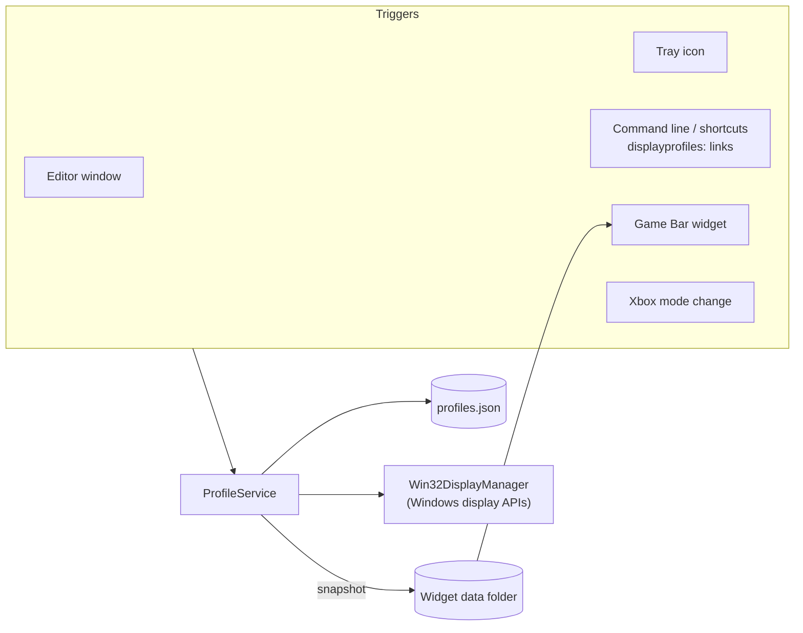

# How Display Profiles works

This is a tour of the moving parts, for anyone curious or about to contribute.

## Projects

| Project | Role |
|---|---|
| `DisplayProfiles.Core` | Everything that is not UI: the display engine, profiles and their storage, the command line, Xbox mode detection, shortcuts, the widget bridge and the gamepad logic. Fully unit-tested. |
| `DisplayProfiles.App` | The WinUI 3 app: the editor, tray icon, single-instance host and the controller layout. |
| `DisplayProfiles.Widget` | The Xbox Game Bar widget (a UWP XAML app) and `DisplayProfiles.Widget.GameBarProjection`, the WinRT projection of the Game Bar SDK it needs. |

The app and the widget are separate programs because Game Bar only hosts UWP widgets, while the app needs full access to the
display APIs, which a sandboxed UWP app does not have.

## Profiles

A profile is a name plus a list of monitors. Each monitor records whether it is enabled, whether it is the main display, its
position, resolution, refresh rate and orientation. Monitors are identified by their EDID hardware id (for example the model
code of your TV), not by Windows' display numbers, which change when you plug things in. Two identical monitors get a `#2`
suffix.

Profiles live in `%APPDATA%\DisplayProfiles\profiles.json` along with the settings. The file is re-read before every change,
so the command line and the GUI never overwrite each other's edits.

## Applying a profile

`Win32DisplayManager` uses `EnumDisplayDevices`, `QueryDisplayConfig` and `ChangeDisplaySettingsEx`:

1. Every monitor's new mode is staged with `CDS_UPDATEREGISTRY | CDS_NORESET`, so nothing visibly changes yet.
2. One final `ChangeDisplaySettingsEx` call applies the whole layout at once. That is what makes switching a single clean
   flicker instead of a series of them.
3. `ProfileService` then checks that the monitors that should be on are on and that the layout matches (refresh rates within
   1 Hz count as equal, because Windows reports 59 Hz for a "60 Hz" mode). A TV that is slow to wake gets up to three
   attempts, 1.5 seconds apart.
4. If it still does not match, or Windows rejected the change, the previous layout is restored.

When you apply from the app, a "Keep these display settings?" prompt waits for you and reverts if you do not answer in time.

### Duplicate displays

A display can be set to duplicate another one (`MonitorConfig.DuplicateOf`) instead of extending the desktop. The old
`ChangeDisplaySettingsEx` API can't express that, so duplicates go through the display-configuration API: in `QueryDisplayConfig`
terms, a mirrored display is a second path that shares the original's *source* (the picture). `Win32DisplayManager`:

- **Reads** active paths and groups the ones that share a source. Windows only lists one monitor of such a group in its
  adapter list, so the others are added from the display configuration and marked as duplicates.
- **Writes** by placing every other display with the normal path first (the duplicate is detached meanwhile, so it can't disturb
  the layout), then adding a path to the same monitor that uses the original's source, with `SetDisplayConfig`.
- **Breaks duplicates up** (`SDC_TOPOLOGY_EXTEND`) before applying anything else, because a mirrored display disappears from
  the adapter list and the normal placement could not find it.

Windows doesn't say which of two mirrored displays is "the original", so a captured layout can name either one. Layouts are
compared as groups (`LayoutMath.AreEquivalent`), and the profile editor always keeps the choice you made. Both displays have to
be reachable from the same graphics output; if they are not, Windows refuses and the previous layout is restored.

## Xbox mode

Windows exposes whether the gaming full-screen experience is active through `IsGamingFullScreenExperienceActive` in
`api-ms-win-gaming-experience-l1-1-0`, plus a change notification. The app loads that API dynamically (so it still starts on
Windows versions without it) and, when the state flips, applies the profile you chose for entering or leaving Xbox mode and
switches the window between the desktop and controller layouts. This is why **Start with Windows** matters: something has to
be running to notice.

## The Game Bar widget

The widget runs in an AppContainer sandbox, so it cannot read the app's files or start the app directly. Instead:

- The app publishes a small snapshot (`profiles.json`: the profile list, the active profile, the last applied profile and
  the last error) into the widget package's own `LocalState` folder.
- The package declares a `displayprofiles:` URI scheme (an unpackaged build registers it under `HKCU\Software\Classes`
  instead). The widget launches `displayprofiles:apply/<id>`, Windows starts (or signals) the app, and the app applies the profile.
- The widget watches the snapshot to show "Switching...", then a check mark, or the error if the switch failed.

The widget is part of the same MSIX as the app, so it is installed, updated and removed together with it. That is also why
the app and the widget share the package's `LocalState` folder: the app finds it from its own package identity
(`PackageIdentity`). Packaged, the app also uses the package for the other things an unpackaged app does through the registry:
Start with Windows is a startup task, the command line is an execution alias (`DisplayProfiles.exe` works from any terminal),
and shortcuts point at that alias. One catch: a compiled `App.xbf` in the package root makes the UWP widget crash on start, so
the app's XAML application class is `MainApp.xaml`.

## Single instance and the command line

Command line verbs and `displayprofiles:` links are handled before the UI starts, so they work without a window. The first
instance of the app owns the tray icon and the Xbox mode watcher; later launches hand their arguments to it and exit.

## Controller mode

Controller mode is the same app with a different shell:

- **Mode selection.** `App.WantsController()` picks the layout: a `--xbox` or `--desktop` flag wins, then the *Controller
  layout* setting, then whether the PC is in Xbox mode. When the answer changes, the window is recreated.
- **Look.** `XboxTheme` overrides a few application resources (the accent colours and the navigation and card surfaces) for
  the Dark, Light or Classic look. `ScaleHost` scales the whole UI up from a 720 dip tall design so it reads across a room.
- **Input.** `XInputPoller` reads the gamepad, `GamepadRepeater` (in Core, unit-tested) turns raw state into edge-triggered
  actions with key-repeat for the D-pad and left stick, and `GamepadNavigator` dispatches them. Focus moves with
  `SpatialFocus`, which understands containers such as expanders. A activates the focused control through its UI Automation
  peer, so it works with every standard control.
- **Controls that do not suit a gamepad** are swapped: combo boxes become `OptionPicker`, which opens a large list in an
  in-window overlay (`OverlayHost`), and the "Keep these settings?" dialog uses the same overlay.
- **Moving displays.** `MonitorLayoutView` implements `IGamepadHandler`. A picks a monitor up, the D-pad jumps between
  positions that touch a neighbour (`LayoutMath.NextSlot`, so monitors never overlap or float), and A drops it.
- **Keyboard stand-ins.** Arrow keys, Enter, Esc, PageUp/PageDown and Y feed the same dispatcher, which is also how the UI is
  tested without a controller.

## Releases

Pushing a tag such as `v0.1.0-beta.1` runs the [release workflow](../.github/workflows/release.yml). It runs the tests,
builds the Game Bar widget and the app for x64 and arm64 and merges them into one MSIX per architecture
(`tools/Build-Package.ps1`), signs the packages with Azure Artifact Signing, and creates the GitHub release. Tags with a suffix are marked as pre-releases.
